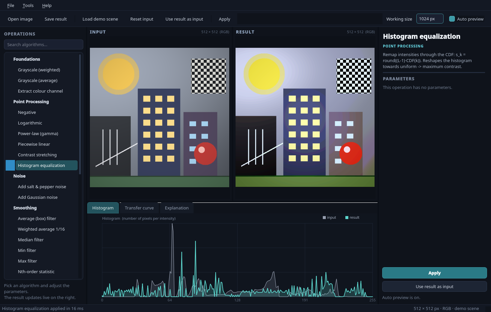

# DIP Lab — topic folders, one algorithm per file

[](https://github.com/Mohammed-Bahr/Digital-Image-Processing-Algorithms/actions/workflows/ci.yml)

A complete implementation of the algorithms in the four DIP lecture notes,
organised by topic, plus a desktop GUI (PyQt5) that loads an image, lists the
algorithms, exposes their parameters, and previews the result live.

The numerical core uses **NumPy**, **OpenCV** and **SciPy**, with NumPy's FFT
for the frequency domain. The lecture-specific formulas are kept: the
histogram-equalisation CDF, the exact filter masks, the symmetric `reflect`
padding, the HOG soft binning and the Harris response.

```
python main.py
```

A synthetic demo scene is loaded on startup, so the app is usable immediately.



---

## Requirements

| Package | Version used | Purpose |
|---|---|---|
| Python | 3.10+ (tested on 3.14) | language |
| NumPy | 2.x | arrays, FFT, numerical work |
| Pillow | 10+ | reading/writing image files |
| PyQt5 | 5.15 | the GUI |
| OpenCV | 4.x | filtering, LUTs, morphology, Harris |
| SciPy | 1.10+ | order-statistic and median filters |

```
pip install -r requirements.txt
```

`requirements.txt` uses `opencv-python-headless` so OpenCV does not install its
own Qt plugins and conflict with PyQt5. If you already have `opencv-python`
installed, that works too.

---

## Project layout

Each topic is a folder; each algorithm is a separate file with its own
`OPERATION` object. `diplab/operations.py` is the only place that links them
together, and the GUI reads that registry.

```
main.py                         launch the GUI
selftest.py                     40 checks against the notes' worked examples
requirements.txt

diplab/
  core/                         shared, algorithm-independent code
    types.py                    Param / OpResult / Operation dataclasses
    utils.py                    dtype + colour helpers, border map, LUTs,
                                correlation, resizing, drawing
    transforms.py               NumPy FFT wrappers, padding, masks,
                                apply_filter (the frequency pipeline)
    dft_reference.py            naive O(N²) DFT/IDFT + the worked example

  foundations/                  notes 00 — colour foundations
    grayscale_weighted.py       I = 0.30 R + 0.59 G + 0.11 B
    grayscale_average.py        I = (R + G + B) / 3
    extract_channel.py          one colour plane

  point_processing/             notes 00 — point operations
    negative.py                 s = 255 - r
    logarithmic.py              s = c log(1 + r)
    gamma.py                    s = c r^γ
    piecewise_linear.py         three segments through two control points
    contrast_stretching.py      min-max / percentile stretch
    histogram_equalization.py   s_k = round((L-1) CDF(k))

  noise/                        noise generators used to test the filters
    salt_and_pepper.py
    gaussian_noise.py

  smoothing/                    notes 01 — smoothing filters
    box_filter.py               uniform k×k average
    weighted_average.py         (1/16)·[[1,2,1],[2,4,2],[1,2,1]]
    median_filter.py            middle rank
    min_filter.py               rank 1
    max_filter.py               rank k²
    nth_order.py                arbitrary rank
    adaptive_local.py           f̂ = g - (σ_η²/σ_L²)(g - m_L)

  sharpening/                   notes 01 — derivatives and sharpening
    common.py                   Sobel/Scharr/Laplacian masks + helpers
    sobel.py                    first-derivative magnitude
    sobel_orientation.py        θ = atan2(Gy, Gx) as hue
    laplacian.py                second-derivative response
    laplacian_sharpening.py     g = f - c ∇²f

  frequency/                    notes 02 — Fourier domain
    common.py                   masks + shared filtering wrapper
    spectrum.py                 centred log-magnitude spectrum
    lowpass.py                  ideal / Butterworth / Gaussian
    highpass.py                 complement, optional rescale
    bandpass.py                 LP(D1) · HP(D0)
    bandreject.py               complement of the band-pass
    notch.py                    two symmetric spikes removed
    homomorphic.py              log → DFT → H → IDFT → exp

  features/                     notes 03 — local features
    harris.py                   cv2.cornerHarris + NMS/thinning
    harris_response.py          positive R map
    hog.py                      HOG descriptor + star visualisation

  operations.py                 registry: imports every OPERATION
  demo.py                       synthetic 512×512 scene
  gui/
    widgets.py                  zoomable canvas, histogram, curve
    main_window.py              browser, live preview, parameter panel
    style.py                    dark stylesheet

docs/screenshot.png
```

### How a module is linked

Every algorithm file ends with one object:

```python
OPERATION = Operation(
    key="box",
    name="Average (box) filter",
    category="Smoothing",
    description="Uniform k × k average ...",
    func=run,
    params=(
        Param("k", "Kernel size", "int", 3, 3, 31, 2),
        Param("border", "Border padding", "choice", "reflect",
              choices=("reflect", "replicate", "zeros")),
    ),
)
```

`diplab/operations.py` imports the module and adds `box_filter.OPERATION` to the
`OPERATIONS` tuple. Adding a new algorithm therefore means:

1. create a new file in the right topic folder,
2. write `run(img, params) -> OpResult` and the `OPERATION`,
3. add one import + one tuple entry in `operations.py`.

The GUI, search, parameter panel, transfer curve and self-test all pick it up
automatically.

---

## Using the GUI

| Area | What it does |
|---|---|
| **Left** | Searchable algorithm tree grouped by note. Click an algorithm to select it. |
| **Centre top** | Input and result side by side. Scroll to zoom, drag to pan, double-click to fit. |
| **Centre bottom** | `Histogram` (input vs result), `Transfer curve` (point operations), `Explanation` (formulas, parameters, timing), plus dynamic tabs for auxiliary images (spectrum, filter mask, Harris response, HOG gradient magnitude, …). |
| **Right** | Theory blurb, parameters, kernel preview (spatial filters), Apply button. |

**Auto preview** is on by default: changing a parameter re-runs the operation
after a short delay. Turn it off for expensive operations and use **Apply**
(F5).

**Working size** (toolbar) caps the processing resolution (default 1024 px,
`Full` for none). NumPy's FFT is fast, so 1024–2048 px is comfortable; the cap
is mainly a memory/safety limit for very large photos.

| Shortcut | Action |
|---|---|
| `Ctrl+O` | open image |
| `Ctrl+S` | save result |
| `Ctrl+R` | reset input to the original |
| `Ctrl+U` | use the result as the new input (chaining) |
| `F5` | apply (when auto preview is off) |
| drag & drop | drop an image file anywhere on the window |

`Tools → DFT worked example` reproduces the 1-D example from Lecture 4;
`Tools → Algorithm map` lists coverage.

Images can be PNG, JPEG, BMP, TIFF, WebP or GIF, grayscale or colour. 16-bit
grayscale is rescaled to 8 bits on load. Colour images are processed per
channel unless the operation is explicitly grayscale (Sobel, Laplacian, Harris,
HOG, spectrum, homomorphic's luminance spectrum).

---

## Algorithm map

### Notes 00 — Foundations & Enhancement (Lectures 1–2)

| Operation | Formula / idea |
|---|---|
| Grayscale (weighted) | `I = 0.30 R + 0.59 G + 0.11 B` |
| Grayscale (average) | `I = (R + G + B) / 3` |
| Extract colour channel | a colour image is three stacked matrices |
| Negative | `s = (L − 1) − r` |
| Logarithmic | `s = c · log(1 + r)`, auto `c = 255 / log(1 + r_max)` |
| Power-law (gamma) | `s = c · r^γ` with `r` normalised to 0..1 |
| Piecewise linear | three segments through `(r1,s1)` and `(r2,s2)` |
| Contrast stretching | `(X − X_min) / (X_max − X_min) · 255`, optional percentile clipping |
| Histogram equalization | `s_k = round((L − 1) · CDF(k))`, applied as a 256-entry LUT |

Point operations are evaluated through `cv2.LUT`, so the transfer-curve panel
and the image result use exactly the same mapping.

> The equalization implementation deliberately uses the lecture's formula
> **without** subtracting `cdf_min`. This reproduces the worked 8-level example
> (`0→1, 1→3, 2→4, 3→5, 4→5, 5→6, 6→6, 7→7`) and is checked by the self-test.

### Notes 01 — Spatial Filters (Lecture 3)

| Operation | Formula / idea |
|---|---|
| Average (box) `k×k` | every coefficient `1/k²`; `cv2.blur` |
| Weighted average | `(1/16)·[[1,2,1],[2,4,2],[1,2,1]]`; `cv2.filter2D` |
| Median | middle value of the sorted neighbourhood; `scipy.ndimage.median_filter` |
| Min / Max | rank 1 / rank `k²`; SciPy minimum/maximum filters |
| Nth-order statistic | rank `n` of `k²`; SciPy `rank_filter` |
| Adaptive local filter | `f̂ = g − (σ_η²/σ_L²)(g − m_L)`, ratio clamped at 1; `cv2.boxFilter` |
| Add salt & pepper | random pixels forced to 0 or 255 |
| Add Gaussian noise | `g = f + η`, `η ~ N(0, σ²)` |
| Sobel / Scharr magnitude | `G = √(Gx² + Gy²)`, optional threshold |
| Sobel / Scharr orientation | `θ = atan2(Gy, Gx)` encoded as hue |
| Laplacian response | 4-neighbour, 8-neighbour and diagonal masks |
| Laplacian sharpening | `g = f − c·∇²f` |

Details that follow the notes:

* **Correlation**, not flipped convolution: `g(x,y) = Σ w(s,t)·f(x+s,y+t)`.
  OpenCV's `filter2D` is used with the lecture's masks.
* Border modes: `reflect` maps to `cv2.BORDER_REFLECT` (symmetric padding,
  matching the note's `3 2 1 | 1 2 3 | 3 2 1` example), `replicate` to
  `BORDER_REPLICATE`, `zeros` to `BORDER_CONSTANT`. SciPy's modes are
  `reflect`, `nearest` and `constant`.
* Smoothing kernels sum to 1 (brightness preserved); derivative and Laplacian
  kernels sum to 0 (constant regions give 0).
* The self-test reproduces the note's numbers: average around 50 → 16,
  weighted → 22, adaptive with `σ_η² = 2` → 9.

### Notes 02 — Frequency Domain (Lecture 4)

| Operation | Formula / idea |
|---|---|
| Fourier spectrum | centred `log(1 + |F|)` display, DC in the middle |
| Low-pass | ideal, Butterworth `1/(1+(D/D0)^{2n})`, Gaussian `exp(−D²/2D0²)` |
| High-pass | complement `1 − H_low`, optional display rescale |
| Band-pass | `H_low(D1) · (1 − H_low(D0))` |
| Band-reject | complement of the band-pass |
| Notch reject | zero two symmetric discs around an offset spike |
| Homomorphic | `log → DFT → H → IDFT → exp`, `H = (γ_H−γ_L)(1−e^{−D²/2D0²}) + γ_L` |

The filters use `numpy.fft.fft2` / `ifft2`. The naive O(N²) DFT is kept in
`core/dft_reference.py` for the lecture's worked example and as an independent
check; it is not used for image filtering.

The distance grid is `D(u,v) = √((u−P/2)² + (v−Q/2)²)` on the **centred**
spectrum. The spectrum is shifted before multiplying by `H` and shifted back
before the inverse transform, so the DC term lines up with the mask centre.
Images are zero-padded to the next power of two; results are cropped back.

### Notes 03 — Image Features (Lecture 5)

| Operation | Formula / idea |
|---|---|
| Harris corners | `M = Σ_w [[Ix², IxIy],[IxIy, Iy²]]`, `R = det(M) − k·trace(M)²`, 3×3 non-maximum suppression, percentile threshold, minimum-distance thinning |
| Harris response map | positive part of `R` rescaled to 0..255 |
| HOG descriptor | gradients `[-1,0,1]`, unsigned orientation folded to 0..180°, soft binning into 9 bins, 8×8 cells, overlapping 2×2-cell blocks with L2 normalisation, plus the star visualisation |

Harris uses `cv2.cornerHarris` for the structure-tensor response (Sobel
derivatives, box aggregation window) and applies the lecture's NMS, percentile
threshold and minimum-distance thinning on top.

HOG is computed from scratch so the descriptor keeps the lecture's plain L2
block normalisation (rather than OpenCV's L2-Hys) and supports any block
stride. OpenCV provides the convolution (`filter2D`) and resizing.

For a 64×128 window with 8×8 cells, 9 bins and 2×2 blocks with stride 1 the
descriptor length is

```
(15 block rows) × (7 block cols) × (2·2 cells × 9 bins) = 3780
```

which is asserted by the self-test.

---

## Self-test

```
python selftest.py
```

It prints one line per check and exits non-zero on failure. The 40 checks cover:

* the NumPy FFT wrappers vs `numpy.fft` (1-D, 2-D, arbitrary axis)
* the Lecture 4 DFT example `[1,2,4,4]`
* the 2-D DFT example `F(0,0)/MN = 10`
* the grayscale weights
* gamma/log/piecewise/contrast-stretch identities
* the Lecture 1 histogram-equalization mapping
* the Lecture 3 numeric examples (average 16, weighted 22, adaptive 9)
* border modes, median denoising, Sobel on a step edge, Laplacian of a flat field
* DC placement in the spectrum, Butterworth `−3 dB` point, band/notch masks
* homomorphic output sanity
* Harris corner locations on a synthetic square and a flat response
* HOG length 3780, per-block L2 norm, and orientation binning
* resize shape
* a smoke test that runs **all 32 operations** on both RGB and grayscale input

Current result: **40 passed, 0 failed**.

---

## Notes and limitations

* The GUI runs operations on the GUI thread. Frequency filters on a 1024 px
  image take tens of milliseconds with NumPy's FFT; on a `Full` 4000 px photo
  they take longer, which is what the working-size cap is for.
* Images are zero-padded before the FFT, so the spectrum describes the padded
  image; the filtered result is cropped back to the original size.
* Colour data is filtered per channel for linear operations. This is the
  straightforward extension of the grayscale theory and can shift saturation
  for non-linear operations such as per-channel equalization.
* Median, min, max and nth-order filters support all three border modes through
  SciPy; OpenCV's median blur does not expose a border mode, so SciPy is used
  here.
* Harris follows the lecture's response and non-maximum suppression, but the
  structure-tensor aggregation is OpenCV's box window. The notes leave the
  window shape open, so this is a valid choice.
* HOG is custom, not `cv2.HOGDescriptor`, to keep the lecture's L2
  normalisation and arbitrary stride. It is still fast for the default
  64×128 window; `keep size` on a large image produces a long descriptor.
* The demo scene is generated procedurally in `diplab/demo.py`; no image assets
  are required.
